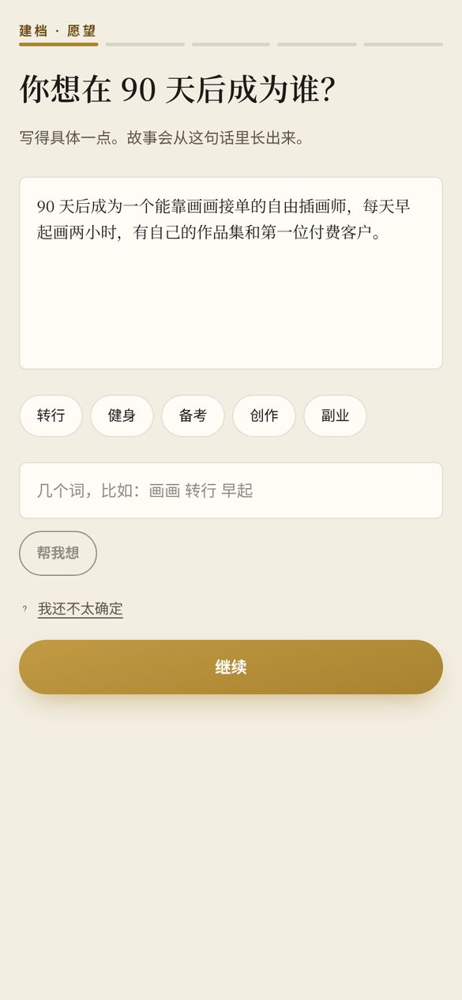
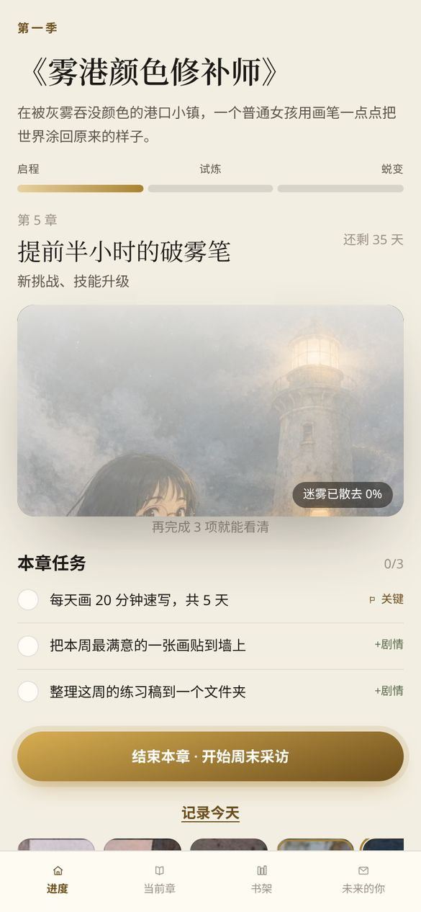
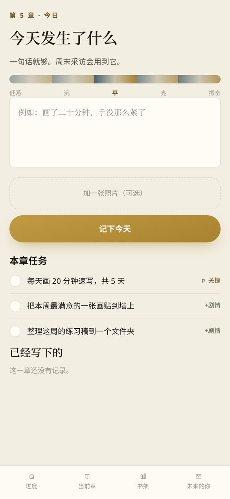

# UworthBetter

> **把你的 90 天，写成一部你会追更的连载。**
> **Turn your next 90 days into a serialized story you can't wait to keep reading.**


**中文**：用户描述"想成为的自己"，应用生成「未来的你」的人格卡与形象，并把 90 天目标编成一季 13 章的图文连载。每周的任务完成度决定下一章是什么样的章节，也决定下一章封面的迷雾散去多少：**不行动，就没有新章节。**

**English**: You describe the person you want to become. The app creates a persona card and portrait for your *future self* and turns your 90-day goal into a 13-chapter illustrated season. Each week, how much you actually did decides what kind of chapter comes next and how much of the next cover's fog clears. **No action, no new chapter.**

---

## 1 分钟上手 · Try it in 1 minute

| 方式 Way | 步骤 Steps |
|---|---|
| **在线 Online** | 打开 <http://101.200.150.64> → 点「载入演示账号」，载入林夏的故事，从揭晓页和第 1 周开始。右下角「演示」菜单可以快进本周或跳到任意一周，直接读到已解锁的章节 / Open the site → tap "载入演示账号" (Load demo account) to start Lin Xia's story at the reveal page and week 1. The "演示" (Demo) menu at the bottom right fast-forwards the week or jumps to any week, so you can read the unlocked chapters right away. |
| **自己的故事 Your own story** | 首页点「开始写你的故事」→ 5 步建档（可用 AI 推荐目标）→ 揭晓未来的你 → 进入第 1 周 / Tap "开始写你的故事" (Start your story) → 5-step onboarding (AI can suggest a goal) → future-self reveal → week 1. |
| **本地 Local** | `pnpm install && cp .env.example .env.local && pnpm db:migrate && pnpm dev`。**无需任何 API Key**（默认 mock 模式）/ **No API key needed** (mock mode by default). |

---

## 评分对照 · Rubric map

| 评分维度 Dimension | 本文对应章节 Section | 关键证据 Key evidence |
|---|---|---|
| **完成度与可用性 Completeness & usability** | [§A](#a-完成度与可用性--completeness--usability) | 在线可用；演示账号一键载入；任意目标都能走完全流程；无 Key 也能本地运行；99 个自动化测试全部通过；真实界面截图 / Live site; one-click demo account; any goal runs the full flow; runs locally without keys; all 99 automated tests pass; real UI screenshots |
| **创意 Creativity** | [§B](#b-创意--creativity) | 行动解锁剧情、迷雾封面、"没有失败，只有不同类型的章节"、真实记录映射成故事隐喻 / Actions unlock the story, fog cover, "no failure, only different chapter types", real logs mapped to story metaphors |
| **场景价值 Scenario value** | [§C](#c-场景价值--scenario-value) | 具体用户画像与使用时刻、研究依据、竞品空白、安全护栏 / A concrete persona and moments of use, research basis, competitor gap, safety guardrails |
| **展示 Presentation**（路演 / live pitch） | [§D](#d-展示--presentation) | 网页路演 `/pitch`、截图 / Web pitch deck `/pitch`, screenshots |

---

## A. 完成度与可用性 · Completeness & usability

### 真实界面 · The real app

以下为应用在本地运行时的截图（2026-10-25，演示账号，移动端 390px 宽）。Screenshots of the running app (2026-10-25, demo account, 390px mobile width).

| 建档 Onboarding | 未来的你揭晓 Reveal | 故事进度 + 迷雾封面 Season + fog cover |
|---|---|---|
|  |  |  |
| **今日记录 Today** | **章节阅读器 Chapter reader** | **书架 Shelf** |
|  |  |  |

### 主流程全部可用 · The full loop works end to end

| 功能 Feature | 位置 Where |
|---|---|
| 5 步建档（可附自拍）+ AI 目标推荐 / 5-step onboarding (optional selfie) + AI goal suggestions | `/onboarding`, `POST /api/goal-suggestions` |
| 未来自我揭晓（人格卡 + 角色设定图 + 第一封信）/ Future-self reveal (persona card, character sheets, first letter) | `/reveal`, `/future` |
| 一季 13 章，分 3 幕 / A 13-chapter season in 3 acts | `/season` |
| 每日任务、心情与一句话记录（可附照片）/ Daily quests, mood, one-line log (optional photo) | `/today` |
| 周末采访 → 章节生成，SSE 实时推送进度 / Weekly interview → chapter generation with live SSE progress | `/chapter/[n]/interview`, `/api/jobs/:id/events` |
| 漫画阅读器：4 格分镜 + 前端叠加中文对白 + 正文 + 来信 / Comic reader: 4 panels, Chinese dialogue overlaid by the frontend, prose, letter | `/chapter/[n]` |
| 迷雾封面随完成度变清晰 / Fog cover clears as quests are completed | `lib/domain/progress.ts` |
| 书架 / Shelf | `/shelf` |
| 演示账号、快进本周、跳到任意一周、重置 / Demo account, fast-forward, jump to any week, reset | `/api/demo/*` |
| 危机关键词检测 + 心理援助热线 / Crisis keyword detection + support hotlines | `lib/ai/safety.ts` |

### 换个输入也能跑 · Works with any input

- **任意目标 Any goal**：建档接受自由文本目标，也可以输入关键词让 AI 推荐 3–4 个 90 天目标草稿。The onboarding accepts any free-text goal, or a few keywords from which AI suggests 3–4 draft 90-day goals.
- **3 种文风 3 art styles**：治愈绘本 / 东方武侠 / 赛博都市，每种有独立配色与固定画风后缀（`lib/ai/styles.ts`）。Healing storybook, Chinese ink wuxia, and cyberpunk, each with its own color theme and a locked art-style suffix.
- **每周任务条数可选 Adjustable quest count**：1–5 条，或交给故事节奏决定。Choose 1–5 quests a week, or let the story pacing decide.
- **完成度决定章节类型 Completion sets the chapter type**：高光 / 挣扎 / 低谷 / 休整四种（`lib/domain/chapterType.ts`，有单测）。Four types: highlight, struggle, low point, rest (`lib/domain/chapterType.ts`, unit-tested).
- **任务自适应是硬规则 Adaptive quests are hard rules**：完成度 <40% 时下周任务全部降为最低难度，并插入"打开工具 5 分钟，做不做都算完成"的启动任务；每周恰好 1 个关键任务（`lib/domain/questRules.ts`，有单测）。After a week under 40%, every quest drops to the lowest difficulty and a "5 minutes counts" starter task is added. Each week has exactly one key quest (`lib/domain/questRules.ts`, unit-tested).

### 为什么稳定 · Why it's reliable

- **契约优先 / Contract-first**：所有 API 请求与响应、AI 结构化输出都用 zod v4 schema 校验（`lib/contracts/`）。`CONTRACTS.lock` 哈希锁定契约文件，测试会检查是否被意外修改。
  Every API request/response and AI structured output is validated by zod v4 schemas. `CONTRACTS.lock` hashes the contract files, and tests fail on unapproved changes.
- **修复重试 / Self-repair**：AI 输出校验失败时，把错误回传给模型重新生成（`lib/ai/providers/openaiCompat.ts`）。If AI output fails validation, the error goes back to the model for a corrected retry.
- **图片失败有占位 / Image failure fallback**：图片 URL 可能为空，前端始终渲染占位。Image URLs may be null, and the frontend always renders a placeholder.
- **无 Key 可运行 / Runs with no key**：默认 mock 模式可走完整流程；测试中禁止调用真实 AI。Mock mode runs the whole flow, and tests never call a real model.
- **质量门禁 / Quality gate**：`pnpm check` = TypeScript strict + ESLint + Vitest。2026-10-25 在 Node 22 上：类型检查与 lint 无错误，15 个测试文件、99 个用例全部通过（覆盖领域规则、前后端契约、任务队列、存储与路演页）。
  `pnpm check` runs TypeScript strict, ESLint, and Vitest. On 2026-10-25 with Node 22: no type or lint errors, and all 99 tests in 15 files pass (domain rules, API contracts, job queue, storage, pitch page).

### AI 与内容来源 · Where the AI content comes from

- **演示季 Demo season**：林夏的 13 章（采访、ChapterPlan、正文、来信）由真实文本模型（智谱 GLM-5.3-flash）离线生成；13 张封面、52 格分镜与角色立绘由真实图像模型（gpt-image-2，经 OpenAI 兼容接口）生成。生成脚本见 `scripts/gen-demo-season.ts`，产物在 `seed/demo-season.json` 与 `public/demo/`。
  Lin Xia's 13 chapters (interviews, chapter plans, prose, letters) were generated offline with a real text model (Zhipu GLM-5.3-flash). The 13 covers, 52 panels, and character art came from a real image model (gpt-image-2 via an OpenAI-compatible API). Script: `scripts/gen-demo-season.ts`. Output: `seed/demo-season.json` and `public/demo/`.
- **应用内实时调用 Live calls in the app**：AI 目标推荐、照片描述可调用真实文本模型；图像生成支持 mock / 智谱 / OpenAI 兼容三种 provider。新建档用户的人格卡、路线图与章节文本当前由模板（mock）生成，整条管线（建档 → 采访 → 章节 → 下周任务）可以完整跑通。所有 AI 调用只经过 `lib/ai/tasks` 一个出口。
  Goal suggestions and photo captions can call a real text model, and image generation supports mock, Zhipu, and OpenAI-compatible providers. For newly onboarded users, the persona, roadmap, and chapter text currently come from templates (mock), and the whole pipeline (onboarding → interview → chapter → next week's quests) runs end to end. All AI calls go through one exit point, `lib/ai/tasks`.
- **现场演示 Live demo**：章节生成可回放演示季内容（`DEMO_CACHED_GENERATE=1`），避免网络波动影响路演。Chapter generation can replay demo-season content (`DEMO_CACHED_GENERATE=1`) so network problems can't break the pitch.

### 演示季插画 · Demo season artwork

| 现在的你 Present self | 未来的你 Future self | 第 1 章 Chapter 1 | 第 13 章 Finale |
|---|---|---|---|
|  |  |  |  |

| 分镜 Panel 4-0 | 分镜 Panel 4-1 | 分镜 Panel 4-2 | 分镜 Panel 4-3 |
|---|---|---|---|
|  |  |  |  |

---

## B. 创意 · Creativity

> 其他产品让你*和*未来的你聊天；我们让你*看着自己变成*未来的你。
> Other apps let you *chat with* your future self. UworthBetter lets you *watch yourself become* them.

1. **行动解锁剧情 / Actions unlock the story**：每周的任务和记录是下一章的素材，结束本章、完成采访后才会生成新章节。"为了看下一章"成了动机。Each week's quests and logs are material for the next chapter, and a new chapter is only generated after you end the week and do the interview. Wanting to read on becomes the motivation.
2. **没有"失败"，只有不同类型的章节 / No "failure", only different chapter types**：完成度 ≥80% 高光章，40–80% 挣扎章，<40% 低谷章，连续两周 <40% 休整章。断签不会被惩罚，而是被写成剧情。≥80% Highlight, 40–80% Struggle, <40% Low point, two weeks under 40% Rest. A missed streak isn't punished. It becomes plot.
3. **迷雾封面 / Fog cover**：下一章封面提前生成并模糊，`blur = 24 × (1 − r)px`。每完成一个任务，雾就散一点。The next chapter's cover is generated early and blurred. Each completed quest clears some of the fog.
4. **真实记录变成隐喻 / Real logs become metaphor**：每章的 ChapterPlan 包含"真实事件 → 故事隐喻"的映射。演示季里，拖延被写成吞没港口颜色的"灰雾"，林夏的速写练习变成了把街道重新上色。Each chapter plan includes a mapping from real events to story metaphors. In the demo season, procrastination is the "grey fog" draining the harbor town's colors, and Lin Xia's sketch practice becomes repainting the streets.
5. **分步章节管线 / A step-by-step chapter pipeline**：先生成结构化 ChapterPlan（节拍、真实事件映射、4 格分镜、伏笔、摘要），再写正文、并行出图（封面、分镜、下一章封面）、写来信（`lib/server/pipeline/chapter.ts`）。
   First a structured ChapterPlan (beats, real-event mapping, 4 panels, foreshadowing, summary), then the prose, parallel images (cover, panels, next chapter's cover), and the letter (`lib/server/pipeline/chapter.ts`).
6. **图中不出现文字 / No text in images**：图像 prompt 统一禁止文字，中文对白由前端叠加在分镜上，避免模型画出乱码汉字；外貌锚点 + 固定画风后缀维持角色一致。Image prompts forbid text, and the frontend overlays Chinese dialogue on the panels, so no garbled characters appear. A fixed appearance anchor plus a locked style suffix keep characters consistent.

---

## C. 场景价值 · Scenario value

### 谁会用、在什么时候用 · Who uses it, and when

**目标用户画像 / Target persona**（设计用画像，演示季的主角 / a design persona, the demo season's protagonist）：林夏，26 岁，互联网运营，想在 90 天内转型成能接单的独立插画师。用过 3 个打卡 App，每个都在第 2 周放弃："断了一天就不想再打开。"但她追漫画、看网文，会为了更新每天打开 App。
Lin Xia, 26, works in internet operations and wants to become a freelance illustrator within 90 days. She has quit three habit apps, each in week 2: "I missed one day and never opened it again." But she follows comics and web novels and opens apps daily for new chapters.

其他典型用户 / Also for：备考学生、求职中的应届生、重启健身的上班族、想写书或做副业的人。Students preparing for exams, new graduates job-hunting, office workers getting back into fitness, people starting a book or side project.

| 时刻 Moment | 发生什么 What happens |
|---|---|
| 周三晚 11 点，很累 / Wed 11 pm, exhausted | 看到"再完成 2 项就能看清"下一章封面，于是做了一个小任务。Sees "2 more and the next cover clears", and does one small task. |
| 周末 / End of the week | 回答 3 个采访问题，读到本周的新章节和"来自未来的信"，看到下周任务。Answers 3 interview questions, reads the new chapter and the letter from the future, and sees next week's quests. |
| 一周没怎么做 / A week mostly missed | 不会被判"断签"，而是进入低谷章；下周任务自动调小，并加入一个 5 分钟就算完成的启动任务。No "streak broken". The story enters a low-point chapter, and next week's quests shrink automatically, with a 5-minute starter task. |

### 为什么有效 · Why it works

| 依据 Basis | 内容 What it shows | 我们怎么用 How we use it |
|---|---|---|
| 未来自我连续性 Future-self continuity | 越觉得未来的自己"是同一个人"，越愿意为长期目标付出（Ersner-Hershfield 2009；Hershfield 2011）/ Feeling connected to your future self increases long-term investment | 可视化的未来自我：人格卡与角色立绘 / A visible future self: persona card and character art |
| 写信给未来 Letters to the future | 给未来的自己写信后，随后几天运动更多（Rutchick 2018）/ Writing to your future self increased exercise in the following days | 每章末「来自未来的信」/ A letter from the future ends each chapter |
| 借来的动机 Borrowed motivation | Finch（为宠物而做）、Zombies, Run!（跑步解锁剧情）/ Finch (care for a pet), Zombies, Run! (running unlocks story) | 为了看下一章而行动 / Act in order to read the next chapter |
| 叙事疗法 Narrative therapy | 问题外化、重写人生故事（White & Epston）/ Externalizing problems, re-authoring one's story | 阻力写成反派，低谷写成章节 / Obstacles become villains, bad weeks become chapters |

**严谨声明 / Honest caveat**：未来自我干预的研究多为短期实验（Grekin 2025 综述），我们**不宣称疗效**，定位为动机与自我反思工具。Most future-self studies are short-term (Grekin 2025 review). We make **no therapeutic claims**. This is a motivation and self-reflection tool.

### 市场空白 · The gap

| 产品 Product | 缺什么 What's missing |
|---|---|
| MyFutureSelf、MIT "Future You" | 对话式、一次性，不绑定长期行动 / Conversational and one-off, not tied to ongoing action |
| Finch | 主角是宠物而不是你 / The hero is a pet, not you |
| Habitica | 固定的游戏模板，故事与你无关 / A fixed game template, and the story isn't about you |
| Zombies, Run! | 剧本预写，只适用于跑步 / Pre-written story, running only |

**我们的定位 / Our position**：个性化视觉叙事 × 真实行动驱动 × 未来自我。我们没有找到同时做到这三点的成熟产品。Personalized visual storytelling × driven by real actions × future self. We haven't found a mature product that combines all three.

### 安全与隐私 · Safety & privacy

- 记录中命中危机关键词时，显示关怀文案与心理援助热线（`lib/ai/safety.ts`）。When a log contains crisis keywords, the app shows a caring message with support hotlines.
- 自拍只用于生成形象，建档完成后即删除（`lib/server/pipeline/onboarding.ts`）。The selfie is used only to generate the character and is deleted after onboarding.
- AI 目标推荐中，涉及身材、饮食的目标一律写成健康版本。Goal suggestions always rewrite body or diet goals in a healthy form.
- 用户输入用 XML 标签包裹，system prompt 声明标签内是数据而非指令，防止提示词注入。User input is wrapped in XML tags declared as data, not instructions, to defend against prompt injection.

---

## D. 展示 · Presentation

- **网页路演 / Web pitch deck**：`/pitch`（大屏路演，图片预加载、断网可用，内嵌可操作的应用）+ `/pitch/notes`（讲者备注）。A full-screen pitch deck with preloaded images that keeps working without network and embeds the live app, plus a speaker-notes window.

---

## 本地运行 · Run locally

```bash
pnpm install
cp .env.example .env.local   # 默认 mock，无需 Key / mock by default, no key needed
pnpm db:migrate
pnpm dev                     # http://localhost:3000 → 「载入演示账号」/ "Load demo account"
pnpm check                   # typecheck + lint + test
```

需要 Node.js 22。真实模型配置（`AI_SUGGEST_PROVIDER` / `AI_IMAGE_PROVIDER` 与对应 Key）见 `.env.example`；部署见 [DEPLOY.md](./DEPLOY.md)。
Requires Node.js 22. Real-model settings (`AI_SUGGEST_PROVIDER` / `AI_IMAGE_PROVIDER` and the matching keys) are in `.env.example`. Deployment steps are in [DEPLOY.md](./DEPLOY.md).

**技术栈 / Stack**：Next.js 16 (App Router) · React 19 · TypeScript strict · Tailwind v4 · zod v4 · Drizzle + SQLite · SSE · Vitest · pnpm

```
Browser (mobile-first)  ──fetch / SSE──►  Next.js Route Handlers (app/api)
                                               │  ok(Schema, data) 契约校验 / contract-validated
                                               ▼
                                   lib/server: 管线 pipelines · job queue · SQLite
                                               │  只经 lib/ai/tasks / only via lib/ai/tasks
                                               ▼
                                   lib/ai: safety · styles · text/image providers
```

## 文档 · Docs

| 文档 Doc | 内容 Contents |
|---|---|
| [DESIGN.md](./DESIGN.md) | 产品设计文档 / Product design document |
| [ENGINEERING.md](./ENGINEERING.md) | 工程方案：契约、任务卡、测试 / Engineering plan: contracts, task cards, testing |
| [DEPLOY.md](./DEPLOY.md) | 部署与运维 / Deployment & operations |
| [CLAUDE.md](./CLAUDE.md) | 团队与 AI 编码代理的开发约束 / Development rules for the team and AI coding agents |
